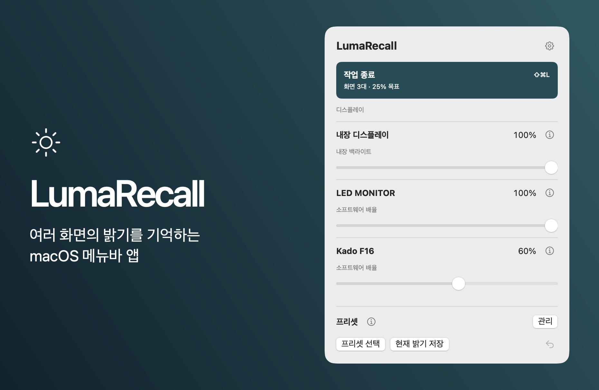

# LumaRecall

[](Assets/menu-bar-preview.png)

*위 화면의 모니터 이름과 밝기는 사용 예시입니다. 앱은 각 Mac에서 활성화된 디스플레이를 자동으로 찾아 표시하며, 처음 설치하면 프리셋 목록은 비어 있습니다.*

작업을 마칠 때 선택한 화면들을 한 번에 어둡게 하고, 돌아오면 **각 화면을 원래 밝기로** 복원하세요. 자주 쓰는 조합은 프리셋으로 저장해 메뉴바나 단축키에서 불러올 수 있습니다.

[설치](#설치) · [첫 사용](#첫-사용) · [프리셋](#프리셋) · [화면 호환성](#화면-호환성) · [CLI](#cli)

## 설치

Mac에 Xcode Command Line Tools가 필요합니다. `xcrun swiftc --version`으로 Swift 버전을 확인한 뒤 실행하세요.

```sh
git clone https://github.com/tomtomjskim/lumarecall.git
cd lumarecall
make app
open .build/LumaRecall.app
```

메뉴바에 **해 모양 아이콘 ☼**이 나타납니다. 앱을 계속 사용하려면 빌드된 `LumaRecall.app`을 응용 프로그램 폴더에 복사하세요.

## 첫 사용

1. **화면 밝기 맞추기** — 메뉴바 패널에서 화면별 슬라이더를 조절하세요. 화면 이름 옆 **ⓘ**에서 별칭을 붙이거나 작업 종료 대상에서 제외할 수 있습니다.
2. **작업 종료와 복원** — 처음에는 25% 밝기를 미리 보여주고 10초 후 자동 복원합니다. 평소에는 패널 상단 버튼 한 번으로 어둡게 하고, 다시 눌러 화면별 이전 값으로 돌아갑니다.
3. **다른 앱에서도 쓰기** — **설정 → 단축키**에서 원하는 조합을 등록하세요. **설정 → 일반**에서 **작업 종료 시 최저 밝기 (1%)**를 켜면 다음 디밍부터 적용됩니다. 단축키의 3초 복원 시험은 별도로 실행할 수 있습니다.

## 프리셋

내장 화면과 메인 모니터는 밝게, 옆에 둔 보조 모니터만 어둡게 쓰는 경우처럼 **화면마다 다른 밝기**를 한 번에 기억합니다.

| 하고 싶은 일 | 메뉴바에서 |
| --- | --- |
| 현재 조합을 바로 저장 | **현재 밝기 저장**. 대상 화면과 밝기로 이름이 붙습니다. |
| 화면 하나만 60%로 저장 | 원하는 화면의 슬라이더를 60%로 맞춘 뒤 **관리 → 화면을 골라 저장**에서 그 화면만 선택합니다. |
| 적용할 값을 먼저 확인 | **프리셋 선택**을 열면 이름 아래에 각 화면의 저장값이 보입니다. 원하는 항목을 누르면 적용됩니다. |
| 직전 밝기로 되돌리기 | **↶**를 누릅니다. 적용 후 외부에서 바뀐 화면은 현재 값을 유지합니다. |
| 특정 조합을 키 하나로 호출 | **설정 → 단축키 → 프리셋 단축키**에서 등록합니다. 조합이 충돌하면 기존 등록값을 유지합니다. |

프리셋으로 밝기를 맞춘 뒤 **작업 종료**로 어둡게 했다면, **복원**을 누르면 작업 종료 직전의 밝기로 돌아갑니다.

## 화면 호환성

| 화면 | 밝기를 바꾸는 방식 |
| --- | --- |
| 내장 디스플레이 | 지원되는 경우 macOS DisplayServices로 백라이트를 조절합니다. 이 비공개 인터페이스는 macOS 버전에 따라 달라질 수 있습니다. |
| 외장 모니터 | CoreGraphics 감마 테이블로 화면 출력을 어둡게 합니다. 슬라이더의 %는 소프트웨어 배율이며 모니터 자체의 백라이트 설정은 유지됩니다. |

실기기 확인 환경은 **Intel Mac · macOS 15.7.9 · 내장 화면 1대와 외장 모니터 2대**입니다. 외장 출력은 감마 테이블 읽기와 쓰기를 지원해야 하며, 색상 프로필이나 다른 밝기 앱의 변경에 영향을 받을 수 있습니다.

<details>
<summary><strong>디밍한 상태에서 모니터를 분리했다면?</strong></summary>

연결된 화면부터 복원하고, 분리한 화면은 다시 연결한 뒤 복원을 누르세요. 앱과 CLI는 화면 UUID별 복원 기록을 공유합니다. 기록은 로컬의 `~/Library/Application Support/NativeDisplayBrightnessToggle/restore.json`에 저장됩니다.

</details>

## CLI

터미널에서도 같은 복원 기록을 사용할 수 있습니다. CLI 디밍 목표는 25%입니다.

```sh
make install
~/.local/bin/display-brightness-toggle list      # 연결된 화면
~/.local/bin/display-brightness-toggle           # 디밍 ↔ 복원
~/.local/bin/display-brightness-toggle dim       # 디밍
~/.local/bin/display-brightness-toggle restore   # 복원
```

Finder에서는 [더블클릭 실행 파일](display-brightness-toggle.command)로 전환할 수 있습니다.

[MIT License](LICENSE) · Swift, AppKit, SwiftUI
